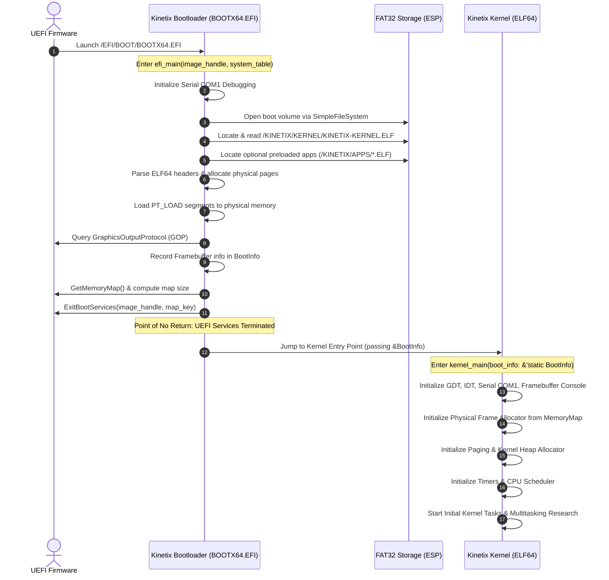

# Kinetix OS — Boot Flow Specification

## 1. Boot Flow Overview

The boot sequence of Kinetix OS is designed to ensure a clean, deterministic, and verifiable transition from firmware-controlled environment to a fully autonomous kernel environment.

---

## 2. Phase-by-Phase Boot Breakdown

### Phase 2.1: Firmware Entry (`BOOTX64.EFI`)
1. **CPU State on Entry**:
   * Processor in 64-bit Long Mode (paging enabled, flat memory model).
   * Execution at Ring 0 (firmware privilege).
   * Interrupts enabled (firmware timer tick active).
   * Calling convention: Microsoft x64 (`rcx` = ImageHandle, `rdx` = SystemTable).
2. **Early Diagnostics**:
   * The bootloader immediately writes initialization headers to COM1 (`0x3F8`) UART port at 115200 baud, 8 data bits, no parity, 1 stop bit (8N1).
   * This guarantees that even if the screen display fails to initialise, serial logs will capture every subsequent step in VirtualBox.

### Phase 2.2: Filesystem & Module Loading
1. Using the `EFI_LOADED_IMAGE_PROTOCOL` and `EFI_SIMPLE_FILE_SYSTEM_PROTOCOL`:
   * Obtain the volume root of the device from which `BOOTX64.EFI` was loaded.
2. Locate `/KINETIX/KERNEL/KINETIX-KERNEL.ELF`.
3. Read the 64-byte ELF Header and verify:
   * `e_ident[EI_MAG0..EI_MAG3] == 0x7F, 'E', 'L', 'F'`
   * `e_ident[EI_CLASS] == 2` (64-bit architecture)
   * `e_ident[EI_DATA] == 1` (Little-endian)
   * `e_type == 2` (Executable binary: `ET_EXEC`) or `3` (`ET_DYN` for PIE)
   * `e_machine == 0x3E` (`EM_X86_64`)
4. Iterate over program headers (`Elf64_Phdr`):
   * For every `PT_LOAD` segment, allocate physical pages via UEFI `AllocatePages` (`AllocateAddress` or `AllocateAnyPages`) marked as `EfiLoaderData`.
   * Copy the segment content into memory and zero out the uninitialized `.bss` region (`p_memsz - p_filesz`).
5. Scan `/KINETIX/APPS/` for native application ELF binaries and stage them into pre-reserved physical memory regions, recording their physical addresses and byte lengths in the `BootInfo` structure.

### Phase 2.3: Graphics Output Protocol (GOP)
1. Query the `EFI_GRAPHICS_OUTPUT_PROTOCOL` (GOP).
2. Query available video modes and select a native 32-bit linear framebuffer mode (preferred: 1024x768 or 1280x720, 32-bpp BGRA/RGBA).
3. Record framebuffer physical base address, horizontal resolution, vertical resolution, stride (pixels per scan line), and pixel format into `BootInfo`.

### Phase 2.4: UEFI Shutdown and Handoff (`ExitBootServices`)
1. Allocate space for the UEFI memory map using `GetMemoryMap`.
2. Retrieve the memory map, recording the memory map buffer pointer, descriptor size, descriptor version, and the critical `MapKey`.
3. Call `ExitBootServices(ImageHandle, MapKey)`.
4. If `ExitBootServices` returns `EFI_INVALID_PARAMETER` (due to an allocation occurring between `GetMemoryMap` and the exit call), retrieve the memory map again and retry immediately.
5. Once `ExitBootServices` succeeds:
   * **UEFI Boot Services are completely disabled.**
   * Timer interrupts are disabled (`cli`).
   * Paging remains as configured by UEFI firmware (identity mapped over physical RAM).
   * Control transfers via a direct jump or call to the kernel entry point address extracted from the ELF header (`e_entry`).

### Phase 2.5: Kernel Entry Point Contract
* **Calling Convention**: System V AMD64 ABI.
* **Arguments**:
  * `rdi`: Physical address of the immutable, static `BootInfo` structure.
* **CPU State Expected by Kernel**:
  * Ring 0, 64-bit Long Mode.
  * Interrupts disabled (`cli`).
  * Stack pointer (`rsp`) set to a valid, dedicated initial stack allocated during the bootloader stage.
  * Paging enabled.
